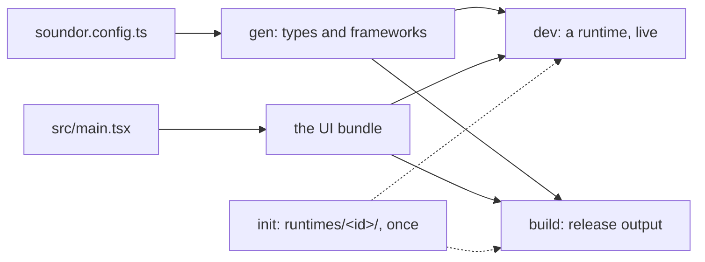

Source: [`packages/cli/`](https://github.com/soundor/soundor/tree/main/packages/cli).

`soundor` runs a project through its lifecycle: it reads `soundor.config.ts`,
generates the plugin's contract, bundles the UI, and drives each runtime.

```sh
pnpm add -D soundor
```

A new project has it already, with package scripts for each command
([`create-soundor-app`](/docs/cli/create-soundor-app)). Run it through your
package manager: `pnpm exec soundor dev web`, or with the scripts, `pnpm dev`
(the project's first runtime).

## Commands

| Command                                      | What it does                                                        |
| -------------------------------------------- | ------------------------------------------------------------------- |
| [`soundor init [runtime]`](/docs/cli/init)   | Writes the runtimes' host projects, once: yours to edit.            |
| [`soundor gen`](/docs/cli/gen)               | Regenerates the types and the runtimes' frameworks from the config. |
| [`soundor dev <runtime>`](/docs/cli/dev)     | Develops with one runtime: builds, watches, reloads the UI.         |
| [`soundor build [runtime]`](/docs/cli/build) | Builds the plugin for release, with every runtime or one.           |
| [`soundor doctor`](/docs/cli/doctor)         | Checks the machine, the config and each runtime's prerequisites.    |
| [`soundor driver`](/docs/driver/cli)         | Inspects a running plugin's native UI (Soundor Driver).             |

Every project command takes `--config <path>`. Without it, the CLI looks for
`soundor.config.ts` in the current directory, then in its parents, so it
runs from anywhere in the project.



`dev` and `build` run `gen` and bundle the UI themselves, so day to day you run
only them. [Project lifecycle](/docs/project-lifecycle) explains which files
each command writes, and which are yours.
