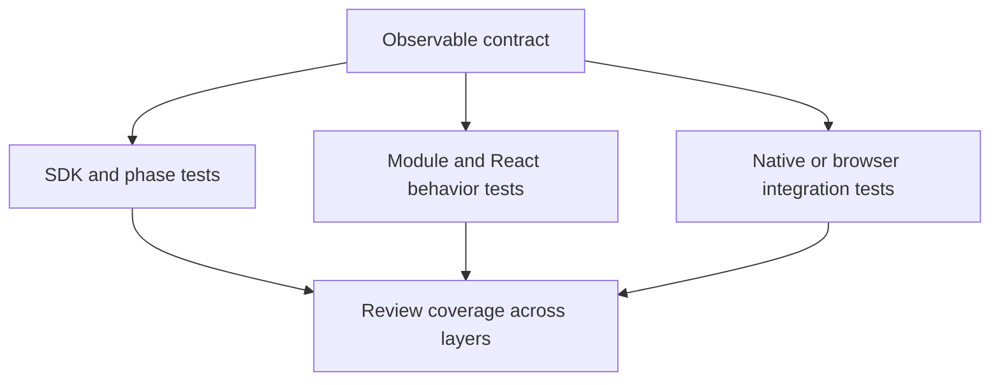

## Purpose

A compatible runtime preserves observable behavior for portable Soundor UI
code. Typechecking and successful lifecycle dispatch cannot establish that.
This page sets a review checklist and proposes a shared test suite; the suite
described below does not exist yet.

## Where the code is

Existing coverage lives in `packages/runtime-sdk/src/*.test.ts`, CLI command
tests, engine `tests/`, web runtime `src/**/*.test.ts`, the test-runtime package,
and `packages/react/testing/`. Native adapter tests and plugin fixtures belong
to the JUCE runtime. Website and DevTools Playwright tests cover their browser
integrations.

## How it works today

| Area                 | Evidence a runtime should provide                                                                                                          |
| -------------------- | ------------------------------------------------------------------------------------------------------------------------------------------ |
| Lifecycle            | Repeat `init` without losing edits; deterministic `gen`; check mode without writes; correct modes and output paths; useful doctor failures |
| Development          | UI marker reload, failed-build recovery, logs, optional terminal integration, cancellation and cleanup                                     |
| Parameters           | Every type, invalid values, range rules, deduplicated changes, subscription teardown, nested gestures and host-originated updates          |
| Native API           | Every supported type, argument order, nested path errors, exceptions, async results and handle validity                                    |
| Host and services    | Snapshots, subscriptions, persistence isolation, absent services, filesystem traversal, atomic writes and error names                      |
| UI                   | Node lifetime, layout defaults, input/focus routing, portals, modals, semantic visibility and accessibility actions                        |
| Animation and canvas | Cancellation, completion, reduced motion, timing, context creation failure and resource teardown                                           |
| Execution            | Supported globals, promise jobs, module loading, assets, production bundle and clean reload with work pending                              |
| Platform             | Real rendering, input, accessibility attachment, audio/host interaction and process coexistence where applicable                           |

Tests should check results, event traces and errors from portable UI code.
Keep pixel and platform assertions in integration suites that can exercise the
real platform. Record unavailable capabilities explicitly; do not silently
count an unexecuted test as proof of support.

## Proposed shared suite

Run the same small UI bundles against an adapter for each runtime. The adapter
would start and stop a host with a known config, run a fixture, deliver host
changes or input, advance time where controllable, and return serializable
results. Those are proposed test-adapter responsibilities, not a current public
SDK API.

Start with parameters, native marshalling, storage/filesystem operations and
module errors. Compare return values, error names and messages, and event order.
Then add UI semantics and animation behavior. Layout, pixels, assistive
technology and audio still need platform-specific coverage.

The engine, web and simulated runtimes should share applicable behavioral
cases. The simulator needs declared limits because it intentionally does not
render or execute DSP. A shared suite should distinguish those limits from a
production runtime failing a required contract case.

## Invariants and tests

The existing suites remain the evidence until a shared harness is implemented.
Do not label a runtime certified by this proposal. A new fixture should be
deterministic, exercise observable behavior and identify which implementation
failed, rather than duplicate private implementation steps.

## How to change it

Introduce the harness as an engineering change with adapters and a small set of
tests already running against multiple implementations. Agree on capability
reporting and time control before adding APIs to the runtime SDK. Keep contract
requirements in the API docs and make the shared cases enforce those
requirements. Add platform-specific regressions alongside them when necessary.
