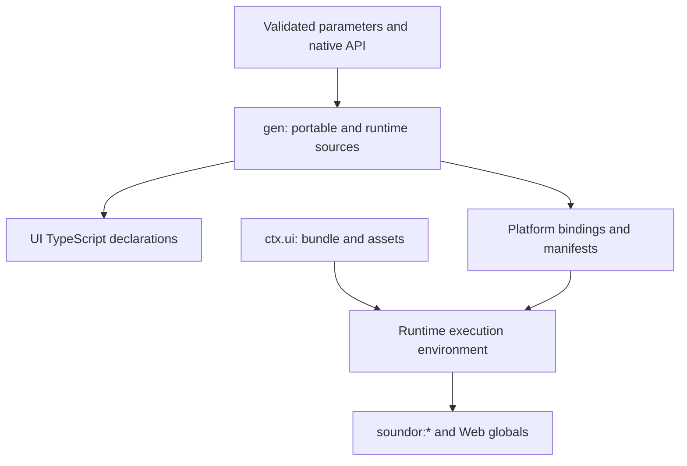

## Purpose

The execution environment makes a CLI-built UI run unchanged. It resolves the
portable modules, supplies the supported Web globals and presents the same
observable behavior on its platform.

## Where the code is

`packages/core/src/generate.ts` assembles the portable declarations from the
`*-dts.ts` generators. `packages/core/runtime/` contains their checked-in shared
forms. The [API pages](/docs/api) specify the modules; engine, web and simulated
implementations and their tests provide the detailed behavior and errors.

## How it works

### UI bundle

`ctx.ui.dir` contains the bundle and its assets. `ctx.ui.module` identifies
`bundle.mjs`, the UI as one ES2023 module, with `bundle.mjs.map` next to it in
development. `soundor:*` imports are left for runtime resolution. Other npm
dependencies have been inlined. A runtime whose engine runs another form makes
it from this one, in a directory of its own: the JUCE runtime lowers it with
`toNativeModule()` from `@soundor/engine/native-module`, the engine it links.

In `soundor dev`, `ctx.ui.live` connects such a runtime to the session.
`live.onBuild(listener)` calls it after every later build, once `build-id` is
written, so the runtime can make its form again. `live.sourceMap(file, map)`
has the CLI map `<file>:line:column` locations in the plugin's log, such as
`/bundle.js:12:5`, through that source map; call it again after rewriting the
map. The CLI maps `bundle.mjs` frames itself.

Production engine builds compile native module sources with the engine's
matching `hermesc` and run bytecode with the compiler excluded. Development
loads live resources. Bundle assets must resolve through the same resource
identity in either mode. `ctx.ui` can be absent for a project with no UI entry.

### Generated contract

Core emits these files under `.soundor/generated/`:

| File              | Contents                                                     |
| ----------------- | ------------------------------------------------------------ |
| `soundor.d.ts`    | Entry referencing the portable declarations                  |
| `assets.d.ts`     | Image and font imports, as their ids (strings)               |
| `parameters.d.ts` | Exactly the configured parameters and their types            |
| `native.d.ts`     | Configured native methods, structs, enums and opaque handles |
| `globals.d.ts`    | Supported Web globals, excluding the full DOM                |
| `platform.d.ts`   | Host, storage and filesystem declarations                    |
| `ui.d.ts`         | Nodes, styles, events, canvases and animations               |

The runtime's `gen` adds platform-specific sources under `ctx.paths.gen` through
`ctx.codegen`. JUCE generates C++ interfaces and bindings plus its build setup;
the web runtime generates manifests, module shims and native API wrappers. A
new runtime should consume the same portable declarations.

### Module behavior

Use the linked API page as the public specification, and the listed code and
tests when matching exact validation, error text and ordering. This table is a
review map, rather than a replacement declaration of each method.

| Module                             | Semantics to preserve                                                                                                                             | Implementation starting points                                                      |
| ---------------------------------- | ------------------------------------------------------------------------------------------------------------------------------------------------- | ----------------------------------------------------------------------------------- |
| [parameters](/docs/api/parameters) | Typed values, clamping and integer rounding, invalid values, deduplicated/coalesced subscriptions, nested gestures and teardown                   | Engine `src/parameters/`, web client `parameters.ts`, generated declarations        |
| [native](/docs/api/native)         | Declared argument order and types, path-specific `TypeError`s, synchronous results versus promises, opaque handle ownership and native exceptions | JUCE `src/native-codegen.ts`, web `src/native-codegen.ts`, core `src/native-api.ts` |
| [host](/docs/api/host)             | Plugin identity, host snapshot and transport shape, change subscriptions, platform availability                                                   | Engine `src/web/`, web client `modules/host.ts` and host context                    |
| [ui](/docs/api/ui)                 | Node ownership, style/layout defaults, input routing, focus, portals, semantic visibility, canvases and animation lifetime                        | Engine `src/ui/` and `src/a11y/`, web client `ui/`, React renderer                  |
| [storage](/docs/api/storage)       | Async key/value operations, serialization, missing values, persistence and isolation by plugin ID                                                 | Engine `src/web/`, web client `storage.ts` and `persistence.ts`                     |
| [fs](/docs/api/fs)                 | Private relative paths, binary/text operations, atomic writes, directory rules and `DOMException` error names                                     | Engine `src/web/`, web client `fs.ts`                                               |

For example, repeated parameter writes of the same value do not produce new
notifications. Nested gestures reach the host as one; an unmatched end is
ignored, and reload closes outstanding gestures. Filesystem traversal and
symlinks escaping the private root are refused. Native argument failures name
the offending method and value path before user code executes.

### Web globals

The portable declarations, generated by `globals-dts.ts`, are the inventory.
They cover the supported timers and animation frames, promises and microtasks,
fetch and its related objects, URL handling, encoding, binary data, logging and
other declared globals. A browser's full DOM is not part of the UI contract.

Read engine `src/web/` and `tests/web/` for edge cases, cancellation and error
behavior. Prefer standard browser facilities when their behavior matches, then
adapt where necessary. A non-browser runtime must also settle asynchronous
operations and promise jobs on the owning JavaScript thread. The simulated
test runtime supports deterministic application tests; it does not implement
every rendering or audio facility of a production runtime.

## Invariants and tests

API success and failure paths, subscriptions, ordering and teardown are all
observable. Engine module suites, web client module/UI suites, generated native
goldens and React tests cover different parts. Rendering and audio require
their own integration tests. [Conformance](/docs/contribute/build-runtime/conformance)
sets out the test coverage a new runtime should assemble.

## How to change it

Start with a contract example that fails in the affected implementations.
Update portable declarations and their doc comments, implement matching
behavior and errors, regenerate affected output, then update the API page.
Avoid making a platform's extra APIs a hidden dependency of portable UI code.
