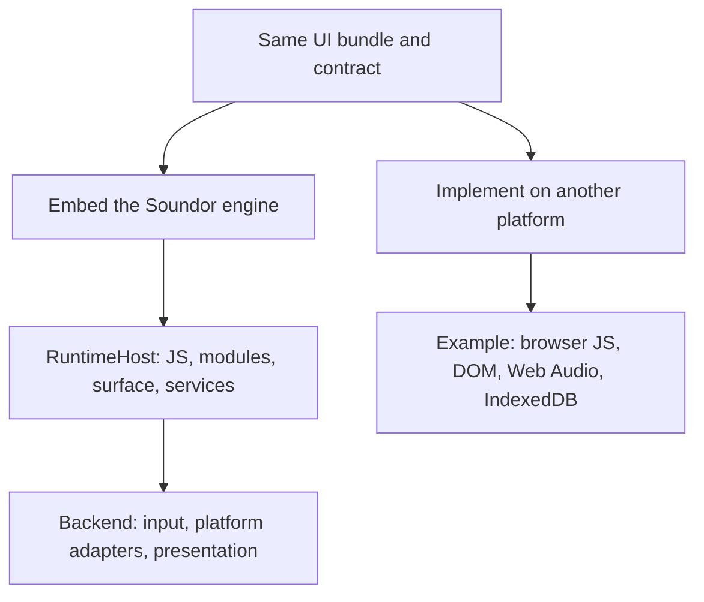

## Purpose

A runtime can reuse Soundor's C++ execution engine or implement the contract on
another platform. The JUCE and web runtimes show these two approaches.

## Where the code is

The engine's public API is under `runtimes/engine/include/soundor/`, especially
`runtime/RuntimeHost.h`, `ui/Surface.h`, `platform/Platform.h` and the compositor
headers. JUCE adapters live in
`runtimes/juce-runtime/native/backend/juce/`. The independent browser
implementation is `runtimes/web-runtime/src/client/`.

## How it works

### Embed the engine

Create one `RuntimeHost` per plugin view on the UI/message thread. Supply its
options: identity, UI resources and entry, parameter and host adapters, HTTP,
private data directory, and an `installModules` callback for generated native
bindings. Optional services have explicit failure behavior; for example,
without a data directory, storage and filesystem operations reject.

Size the surface and feed it input through the public surface API. Call
`tick()` regularly on the owning thread to deliver changes, timers, animation
callbacks and completed async work. Run pending jobs after input. Present
damaged frames through the compositor; supply a shared GPU device when the
presentation backend supports it. Connect the surface's semantic tree to a
platform accessibility backend.

The engine owns Hermes, Yoga, Skia, modules and UI state. The backend owns the
native view, platform integration and presentation. Keep JUCE and other
framework headers out of the engine. See the
[embedding reference](/docs/contribute/engine-reference#embedding-api) for the
API and [threading rules](/docs/contribute/engine-reference#threading-and-lifetime).

Reload means destroying the host and creating a new one. Audio-thread listeners
set lock-free flags; `tick()` delivers their changes on the UI thread. Background
workers return plain C++ results and operation IDs, never JavaScript values.

### Implement from scratch

Provide a module resolver, the Web globals subset, platform services and a
`soundor:ui` implementation with the shared semantics. The React renderer talks
to nodes through that module; it does not require the C++ engine.

The web runtime uses browser JavaScript and DOM nodes, Web Audio for audio, and
IndexedDB for persistence. It supplies Soundor layout defaults, focus and event
routing, semantic visibility and animation behavior on top of browser APIs.
User-defined native API functions run as TypeScript in the same host context.
No Hermes, Yoga, Skia or WASM runs in the web implementation.

This route avoids the engine ABI, but it owns every semantic adaptation. DOM
defaults alone do not establish conformance. Compare invalid values, event
ordering, private persistence and teardown as carefully as successful rendering.

### Case study: JUCE

The Node package generates C++ interfaces, native marshalling and CMake setup.
The user owns the processor and other starter host files. JUCE adapters connect
parameters, HTTP, host information and editor integration to `RuntimeHost`.
The engine supplies the UI execution and rendering layers. The runtime builds
the requested formats and makes signing the final macOS bundle step.

### Case study: web

The Node package generates the manifest and module wrappers, and configures Vite
to resolve `soundor:*`. A browser host context connects UI, parameters, native
functions and audio. The Preact shell hosts controls around the plugin viewport.
Embed and playground modes reuse that client with different presentation and UI
loading. See [the web runtime](/docs/web-runtime).

## Invariants and tests

Engine integrations must preserve UI-thread ownership, clean reload, symbol
isolation and GPU lifetime. The engine's native tests exercise these contracts;
JUCE's adapter and test-plugin suites check its embedding. A different backend
needs its own view/input/presentation integration tests too.

Independent implementations must prove the same observable API semantics.
Web client unit tests cover modules and nodes, while browser tests check actual
DOM behavior and the full hosted application. Neither route can substitute
lifecycle tests for execution tests.

## How to change it

For an engine backend, implement public adapter interfaces and keep framework
code in the backend. Use the exact engine version for headers, static libraries
and bytecode tooling; preserve its hidden symbols and inline ABI namespace.
For an independent runtime, inventory the contract and build tests for each
platform adaptation. Both routes should report unsupported capabilities through
the contract's defined behavior, such as a `null` WebGL context without a device.
