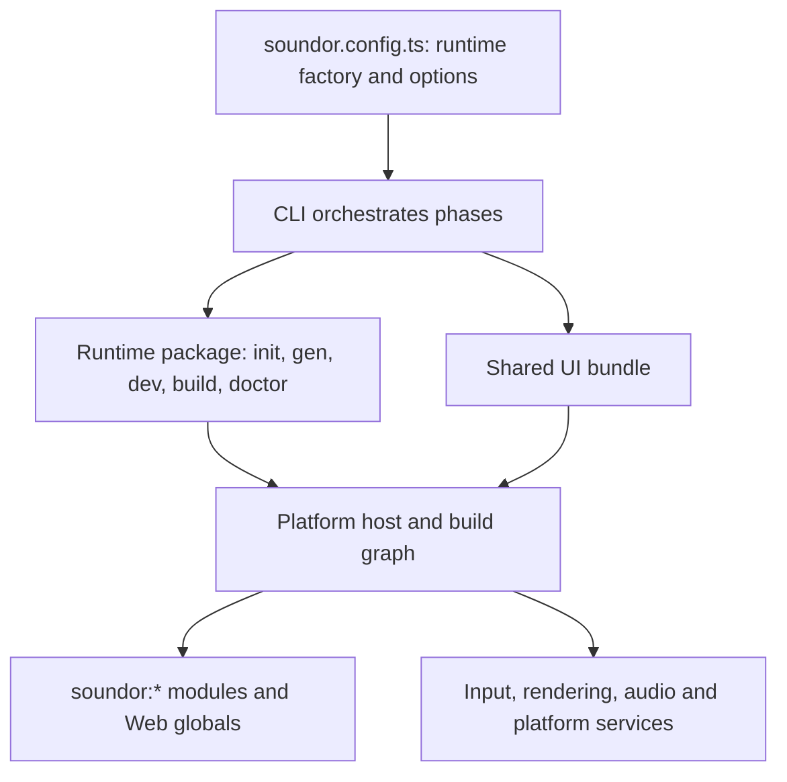

## Purpose

A runtime makes a Soundor plugin run on a platform. It supplies both a Node-side
toolchain integration and the execution environment that implements the
plugin-facing contract. A lifecycle factory alone is the first half of that job.

## Where the code is

The lifecycle types live in `packages/config/src/runtime.ts` and `context.ts`.
`packages/runtime-sdk/src/runtime.ts` implements `defineRuntime()`. The reference
implementations are `runtimes/juce-runtime/` and `runtimes/web-runtime/`.
`packages/core/src/` generates the portable declarations.

## How it works

The runtime package exports a factory made with `defineRuntime<Options>()`.
Calling it returns a live descriptor for `config.runtimes[]`; the CLI resolves
its ID and calls its implementation. Options are owned and validated by the
runtime. The SDK preserves their TypeScript type, but does not validate their
values for you.

The runtime decides how to host audio and user code, launch development,
compile a production artifact and diagnose prerequisites. The CLI owns UI
bundling, portable code generation and command presentation. A new runtime
should fit that boundary without adding runtime-specific branches to the CLI.

## Reading path

1. [Lifecycle and tooling](/docs/contribute/build-runtime/lifecycle): phases,
   context, paths, development protocol, signing and DevTools.
2. [Execution contract](/docs/contribute/build-runtime/contract): bundles,
   generated files, every `soundor:*` module and Web globals.
3. [Implementation choices](/docs/contribute/build-runtime/implementation):
   embed the Soundor engine or implement the contract on another platform.
4. [A minimal runtime package](/docs/contribute/build-runtime/walkthrough):
   build the lifecycle integration, then connect execution.
5. [Conformance](/docs/contribute/build-runtime/conformance): what to test now
   and a proposed suite shared by all runtimes.
6. [Publishing](/docs/contribute/build-runtime/publishing): entry points, peers,
   engine compatibility and packed consumer checks.

## Invariants and tests

The same UI must see the [cross-runtime contract](/docs/contribute/contract).
User-owned host files survive `init`; generated framework files are
deterministic. Development aborts cleanly, and reloading releases the previous
UI's subscriptions, jobs and resources.

SDK lifecycle tests check factory and dispatch behavior. Runtime phase tests
exercise the Node-side integration. Native suites, browser suites and real
plugin fixtures test execution. Passing SDK tests alone cannot establish
runtime conformance.

## How to change it

Choose the execution platform before designing generated sources. Map every
portable API to a platform service, including failures when a service is
unavailable. Establish tests for values, errors and teardown, then wire the
lifecycle around that implementation. Follow the JUCE and web implementations
as case studies, checking which behavior belongs to their platform and which
belongs to the shared contract.
