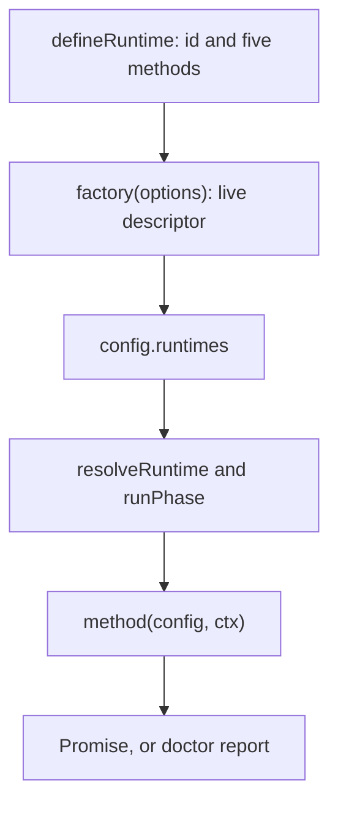

## Purpose

The lifecycle lets the CLI drive any runtime with the same operations. Runtime
authors own the concrete build and server processes while the CLI owns command
orchestration and the shared UI bundle.

## Where the code is

Read `packages/config/src/runtime.ts`, `context.ts` and `registry.ts` for the
contract and dispatch. `packages/runtime-sdk/src/index.ts` re-exports the types,
helpers and errors a runtime author needs. Command orchestration lives in
`packages/cli/src/commands/`.

## How it works



All five methods are required. They receive the parsed `SoundorConfig` and a
`LifecycleContext<Options>`:

| Phase    | Responsibility                                                       | Result                  |
| -------- | -------------------------------------------------------------------- | ----------------------- |
| `init`   | Write missing user-owned host files; preserve edits on repeat runs   | `Promise<void>`         |
| `gen`    | Emit deterministic relative paths and contents through `ctx.codegen` | `Promise<void>`         |
| `dev`    | Run the long-lived development workflow until `ctx.signal` aborts    | `Promise<void>`         |
| `build`  | Produce production output under `ctx.paths.dist`                     | `Promise<void>`         |
| `doctor` | Diagnose toolchain and environment readiness                         | `Promise<DoctorReport>` |

A doctor report contains `checks`, each with `label`, `status` (`ok`, `warn` or
`fail`), optional `detail`, and an actionable `suggestion` when useful.

### Context

| Field                      | Meaning                                                          |
| -------------------------- | ---------------------------------------------------------------- |
| `phase`, `mode`            | Current phase and `debug` or `production` mode                   |
| `runtimeConfig`, `options` | Selected runtime ID and runtime-owned options                    |
| `paths`                    | Absolute project root, config, generated, cache and output paths |
| `fs`                       | Filesystem interface, replaceable in tests                       |
| `logger`                   | Structured runtime logger; use its pipe for subprocess output    |
| `codegen`                  | Collection sink for generated sources                            |
| `ui`                       | Optional CLI-produced bundle, supplied to dev/build              |
| `session`                  | Optional development terminal integration                        |
| `signing`                  | Signing policy already resolved by the CLI's dispatcher          |
| `devtools`                 | Optional credentials for an active supported debug session       |
| `signal`                   | Cancellation of long-lived operations                            |

Use `ctx.paths.gen`, `cache` and `dist` rather than inventing output locations.
[Ownership](/docs/contribute/ownership) describes which files may be rewritten.
`FileSystemHost` resolves relative paths against the project root; it also
accepts absolute paths and is not a filesystem sandbox.

`runPhase()` defaults to debug mode; production build orchestration passes
production explicitly. It preserves `SoundorError` subclasses and wraps other
exceptions as `RuntimeError` with the runtime ID, phase and cause. Use `EnvError`
for a missing prerequisite and a message that identifies the fix.

### Development protocol

The CLI keeps the UI bundle directory current and rewrites `build-id` last on
each successful build. Watch that marker, load from the live directory and
reload the UI without requiring a host build for every UI edit. The native
runtime replaces the entire `RuntimeHost` on reload.

When `ctx.ui.live` exists, append UI logs to its `logFile`, one JSON object per
line with `level`, `source` and `message`. The CLI tails it and applies source
maps. Send build process output through `ctx.logger.pipe` (as `runCommand`
does); the CLI keeps it in `.soundor/dev/build.log` and collapses it to progress
in an interactive terminal.

Call `ctx.session?.ready(rows)` once the runtime is usable, and again after a
runtime rebuild. Each row has `label` and `value`, such as a URL. Register a
runtime shortcut with `ctx.session?.shortcut({ key, description, action })`.
The CLI reserves `h`, `u`, `o`, `c` and `q`. Session integration is optional:
development must also work when the host supplies no terminal session.

Check `ctx.signal.aborted` before starting work, pass the signal to subprocess
helpers, and close servers, watchers and child processes during cleanup. Handle
a signal that was already aborted before registering an event listener.

### Signing

Use the resolved `ctx.signing`: `SOUNDOR_MACOS_SIGNING_IDENTITY` takes precedence
over config `signing.macos.identity`, then the default is ad-hoc (`-`). Pass
through the optional keychain too. Do not re-resolve environment variables in
the runtime.

Sign macOS binaries after every build step that writes into their bundles. For
a non-ad-hoc identity, use `--options runtime --timestamp`. Soundor does not
manage signing key material or notarization. The JUCE implementation finalizes
signing with `soundor_finalize_plugin`.

### Optional DevTools

Declare static support on the definition passed to `defineRuntime()`:

```ts
capabilities: {
  devtools: { inspector: true, accessibility: true, animations: true, performance: true },
},
```

All flags are optional; `{ devtools: {} }` declares basic connection support.
Omit `devtools` when unsupported. Connected instances negotiate their own
subset separately. The web runtime currently omits this capability.

Dispatch forwards `ctx.devtools` only during debug `dev` for a runtime declaring
support. It can still be absent when infrastructure is disabled or unavailable.
Its endpoint, session ID and token are secrets: do not log them, embed them in
production output or pass them as process arguments. A launcher can pass the
protected `descriptorPath` instead. See [the protocol](/docs/contribute/devtools-protocol).

## Invariants and tests

`packages/runtime-sdk/src/runtime.test.ts` and `lifecycle.test.ts` cover the
factory and context flow; config registry tests cover error wrapping and
capability gating. Runtime phase tests cover actual build arguments, output
paths, aborts and preservation of user files. CLI command and dev tests cover
the caller's side of the protocol.

## How to change it

Add shared context fields in config, forward them in dispatch, re-export them
from the SDK, and exercise both supported and absent cases. A runtime-specific
option belongs in its own `Options`, with runtime validation and phase tests.
Update the command and runtime-authoring documentation together.
