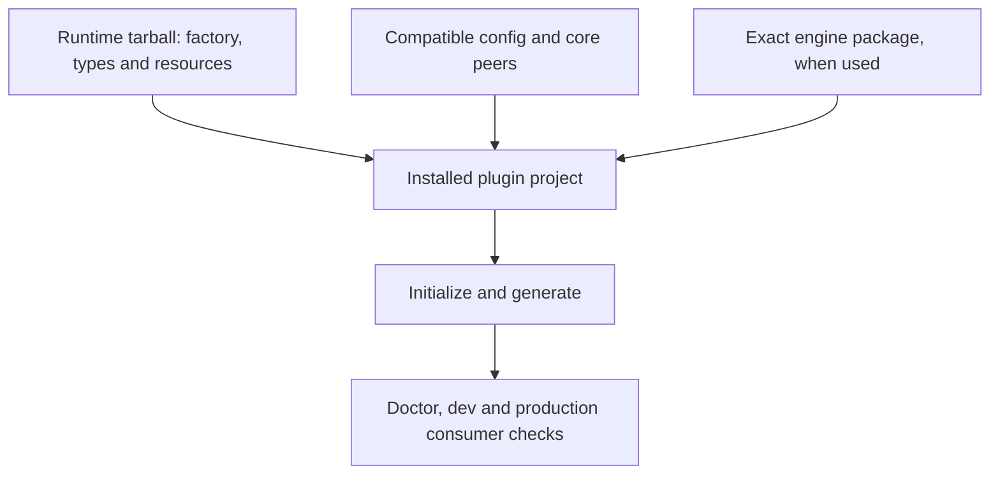

## Purpose

A runtime package needs to work from an installed tarball in a plugin project,
with the matching Soundor contracts and platform resources available. A workspace
build alone does not establish that packaging boundary.

## Where the code is

Use `runtimes/juce-runtime/package.json` and `runtimes/web-runtime/package.json`
as reference manifests. `packages/runtime-sdk/package.json` declares the SDK's
peers. The engine's public ABI and prebuilt checks are documented in
[Soundor Engine](/docs/engine#abi-versioning) and the
[engine reference](/docs/contribute/engine-reference#prebuilt-engines).

## How it works

### Name and exports

Choose a descriptive npm name such as `soundor-runtime-<platform>` or a scoped
equivalent. This is a naming recommendation, not a discovery mechanism: the
config imports the package's factory explicitly. Choose a stable runtime ID
that does not collide with other runtimes in the same config.

Export the ESM factory and its TypeScript declarations through `exports`.
Include the generated JavaScript, declarations and runtime resources in the
package's `files` list. Resolve packaged templates, CMake support or browser
resources relative to `import.meta.url`, rather than the consumer's current
working directory. Exercise those paths from an installed tarball.

### Dependencies and peers

Declare the config and core versions your runtime supports as peers, and test
the range you claim. The reference runtimes use peers for these shared contracts
and development dependencies for workspace builds. A third-party package should
choose its range from tested compatibility, rather than copy a broad range
without checking it.

If emitted code imports the runtime SDK, include it as a runtime dependency.
If the bundler inlines its implementation, it can be a build dependency; its
config/core peers still need to resolve in the consumer. Review the emitted
entry point to make that choice.

Before 1.0, plugin projects pin exact Soundor versions. Document your runtime's
tested versions and upgrade steps. Keep your package version and the engine ABI
version distinct: they describe different compatibility boundaries.

### Engine compatibility

An engine-based runtime depends on the exact engine version it was built
against. That selects its headers, libraries, bytecode compiler and inline ABI
namespace together. Do not use a semver-compatible engine library with headers
from another exact version. Source and prebuilt modes must preserve the same
contract and version checks.

An independent runtime, such as the web implementation, does not link the C++
engine. It still needs compatible declarations and observable module behavior.

## Invariants and tests

Check a packed installation in a fresh consumer: import the factory, load config,
initialize twice, generate and check, run doctor, and exercise development and
production output. Include assets and user-defined native API types in the
fixture so missing package resources or dependencies are exposed.

Add the execution and platform coverage from
[Conformance](/docs/contribute/build-runtime/conformance). For engine embeddings,
also check symbol isolation and coexistence with another plugin binary. Keep
dependency notices with any native dependency archives you distribute.

## How to change it

When changing exports, dependency ranges or packaged files, run consumer checks
against the packed result. Treat an engine upgrade as a rebuild of every
component tied to its ABI and bytecode. Document required user-owned host-file
edits; new `init` templates cannot migrate existing files automatically.
