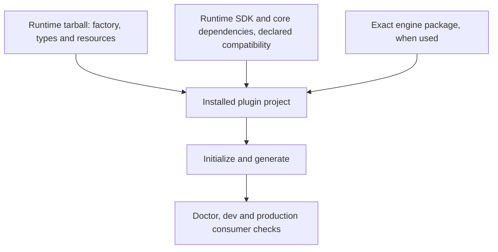

## Purpose

A runtime package needs to work from an installed tarball in a plugin project,
with the matching Soundor contracts and platform resources available. A workspace
build alone does not establish that packaging boundary.

## Where the code is

Use `runtimes/juce-runtime/package.json` and `runtimes/web-runtime/package.json`
as reference manifests, including their `soundor.compatibility`. The engine's public ABI and prebuilt checks are documented in
[Soundor Engine](/docs/engine#abi-versioning) and the
[engine reference](/docs/contribute/engine-reference#prebuilt-engines).

## How it works

### Name and exports

Choose a descriptive npm name such as `soundor-runtime-<platform>` or a scoped
equivalent. This is a naming recommendation, not a discovery mechanism: the
config imports the package's factory explicitly. Choose a stable runtime ID
that does not collide with other runtimes in the same config.

Export the ESM factory and its TypeScript declarations through `exports`.
Include the generated JavaScript, declarations and runtime resources in the
package's `files` list. Resolve packaged templates, CMake support or browser
resources relative to `import.meta.url`, rather than the consumer's current
working directory. Exercise those paths from an installed tarball.

### Dependencies and compatibility

The reference runtimes depend on `@soundor/runtime-sdk`, and on
`@soundor/core` where they import it, as regular dependencies: their emitted
code imports both. They depend on `@soundor/config` too, because their
declarations name its types: the factory is typed `RuntimeFactory<Options>`
from `@soundor/config`, which every project installs, so a project's
declarations (`composite` projects emit them) can name its config's type; a
type named through `@soundor/runtime-sdk`, which the project does not
install, cannot be. The CLI's own copy parses the project's config. Review the emitted entry
point and declarations (`dist/*.mjs`, `dist/*.d.mts`) to check that every
package they import is declared. See
[Dependencies and compatibility](/docs/contribute/compatibility) for the rules.

Declare the host versions the runtime supports in `soundor.compatibility` and
pass it to `defineRuntime()`'s `package`: the CLI refuses the runtime, before
running any phase, when the project's Soundor is outside it. These ranges say
what you have tested, not what you depend on: widen them only after running
your tests against the new version.

Before 1.0, plugin projects pin exact Soundor versions. Document your runtime's
tested versions and upgrade steps. Keep your package version and the engine ABI
version distinct: they describe different compatibility boundaries.

### Engine compatibility

An engine-based runtime depends on the exact engine version it was built
against. That selects its headers, libraries, bytecode compiler and inline ABI
namespace together. Do not use a semver-compatible engine library with headers
from another exact version. Source and prebuilt modes must preserve the same
contract and version checks.

An independent runtime, such as the web implementation, does not link the C++
engine. It still needs compatible declarations and observable module behavior.

## Invariants and tests

Check a packed installation in a fresh consumer (as
`packages/cli/scripts/runtime-consumer-smoke.mjs` does for the reference
runtimes): import the factory, load config,
initialize twice, generate and check, run doctor, and exercise development and
production output. Include assets and user-defined native API types in the
fixture so missing package resources or dependencies are exposed.

Add the execution and platform coverage from
[Conformance](/docs/contribute/build-runtime/conformance). For engine embeddings,
also check symbol isolation and coexistence with another plugin binary. Keep
dependency notices with any native dependency archives you distribute.

## How to change it

When changing exports, dependency ranges or packaged files, run consumer checks
against the packed result. Treat an engine upgrade as a rebuild of every
component tied to its ABI and bytecode. Document required user-owned host-file
edits; new `init` templates cannot migrate existing files automatically.
