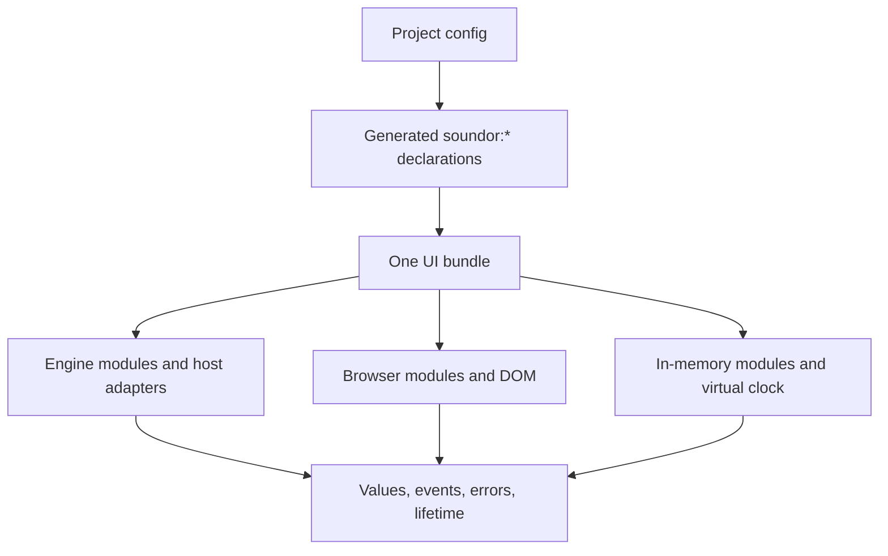

## Purpose

A plugin UI is written once. Runtime implementations make its parameters,
native API, services, UI and Web globals behave consistently. Matching TypeScript
signatures is only one part of that contract: values, ordering, errors and
lifetime are observable too.

## Where the code is

| Layer                            | Source                                                           |
| -------------------------------- | ---------------------------------------------------------------- |
| Contract declarations            | `packages/environment/`, `packages/core/src/*-dts.ts`            |
| React mapping                    | `packages/react/src/`                                            |
| Native implementation            | `runtimes/engine/src/`, JUCE host adapters                       |
| Browser implementation           | `runtimes/web-runtime/src/client/`                               |
| Simulated implementation         | `packages/test-runtime/src/`                                     |
| Application-facing specification | [API](/docs/api), [React](/docs/react), [testing](/docs/testing) |

## How it works

The six modules are `soundor:parameters`, `soundor:native`, `soundor:host`,
`soundor:ui`, `soundor:storage` and `soundor:fs`. Config generates parameter and
native API types (`packages/core/src/*-dts.ts`); the other declarations
describe the shared platform, the same for every plugin, and are written by
hand in `packages/environment/`. The
[runtime contract guide](/docs/contribute/build-runtime/contract) maps each
module to its specification and implementations.

The web runtime implements the contract directly with browser services. It
reproduces native parameter clamping and gesture rules, event routing, layout
defaults, semantic visibility and relevant errors. Browser APIs can expose
more than the portable surface, so plugin UI code compiles without TypeScript's
full `DOM` library. Browser host code has its own DOM-enabled configuration.

The test runtime provides deterministic application behavior: in-memory nodes,
parameters, services and a virtual animation clock. It does not prove pixels,
layout, native execution or audio processing. Those need platform tests.

## Invariants and tests

An implementation must preserve the contract's observable behavior, including
invalid input and teardown. Accessibility roles and visibility belong to
Soundor's semantic tree; native bridges and web ARIA consume those semantics.
JUCE provides a host view, rather than defining control semantics.

Tests live with each implementation: engine module and UI suites, browser
client module and UI tests, test-runtime suites, and the React testing
workspace. There is currently no single shared suite certifying all runtimes;
[Conformance](/docs/contribute/build-runtime/conformance) describes a proposal
and the existing test layers to use today.

## How to change it

Trace the value from its public declaration through React, if applicable, into
every implementation. Add a failing test at the layer owning the behavior,
then corresponding cases for the other runtimes. Regenerate declarations and
native golden output when affected. Update the API or component page, including
doc comments, alongside the implementation.

Distinguish a platform capability from a semantic difference. For example,
WebGL context creation may return `null` without a device; a runtime still
must implement that failure path and preserve the rest of the UI.
