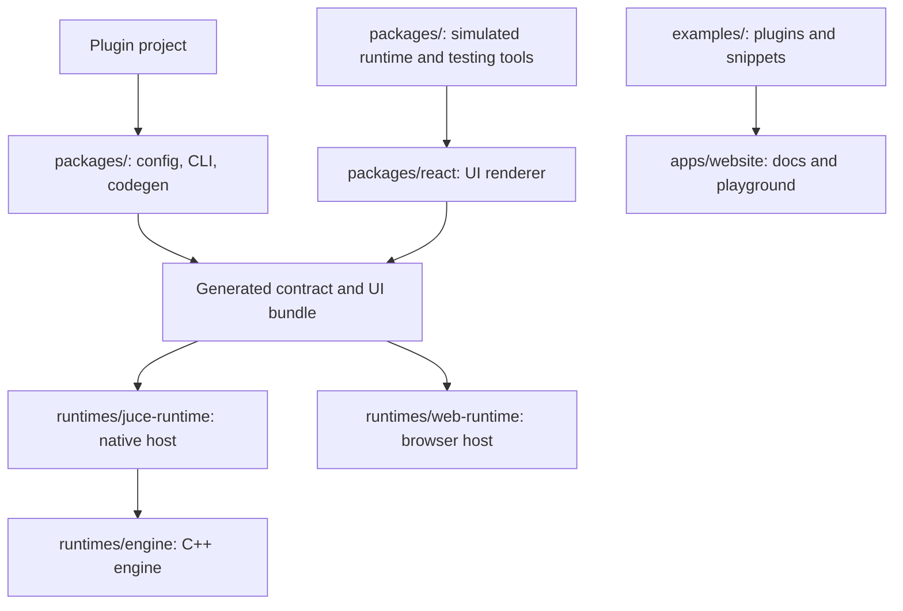

Start here when changing Soundor itself. To build a plugin with published
packages, use [Getting started](/docs/getting-started).

Read [Setup](/docs/contribute/setup), then [Workflow](/docs/contribute/workflow)
and [Conventions](/docs/contribute/conventions). Subsystem guides describe their
purpose, source, operation, invariants and tests, and how to change them.

## Repository map

The [package map](/docs/contribute/packages) gives dependency direction and
ownership. `configs/` contains private TypeScript and bundler presets;
`tools/benchmark/` measures the native runtime; `.github/` owns CI and releases.

## Where to start a change

| Change                                | Read first                                                                                                                             | Main source                                                            |
| ------------------------------------- | -------------------------------------------------------------------------------------------------------------------------------------- | ---------------------------------------------------------------------- |
| A config option or generated type     | [Pipeline](/docs/contribute/pipeline), [ownership](/docs/contribute/ownership)                                                         | `packages/config/src/`, `packages/core/src/`                           |
| A CLI command or dev session          | [Pipeline](/docs/contribute/pipeline), [Runtime SDK](/docs/contribute/runtime-sdk)                                                     | `packages/cli/src/`                                                    |
| A new runtime                         | [Build a runtime](/docs/contribute/build-runtime)                                                                                      | `packages/config/src/runtime.ts`, `packages/runtime-sdk/src/`          |
| A shared UI or service behavior       | [Cross-runtime contract](/docs/contribute/contract)                                                                                    | Engine, web runtime, test runtime and React                            |
| Native layout, painting or JavaScript | [Engine reference](/docs/contribute/engine-reference)                                                                                  | `runtimes/engine/include/`, `runtimes/engine/src/`                     |
| Native host integration               | [Embedding API](/docs/contribute/engine-reference#embedding-api)                                                                       | `runtimes/juce-runtime/native/backend/juce/`                           |
| Accessibility                         | [Contract](/docs/contribute/contract), [Apple bridges](/docs/contribute/apple-accessibility)                                           | Engine `src/a11y/`, web client `ui/semantics.ts`                       |
| React or application tests            | [React tests](/docs/contribute/react-tests), [test runtime](/docs/contribute/test-runtime)                                             | `packages/react/`, `packages/react/testing/`, `packages/test-runtime/` |
| DevTools                              | [Protocol](/docs/contribute/devtools-protocol), [server](/docs/contribute/devtools-server), [client](/docs/contribute/devtools-client) | `packages/devtools-*/`                                                 |
| Performance                           | [Benchmarks](/docs/contribute/benchmark)                                                                                               | `tools/benchmark/`                                                     |
| Docs, snippets or playground          | [Conventions](/docs/contribute/conventions)                                                                                            | `apps/website/`, `examples/snippets/`                                  |

## Follow a behavior across implementations

For a parameter change, start with config validation and generated declarations,
then trace its host representation and subscriptions through both runtimes. For
a React prop, start with its type and reconciler mapping, then follow the
`soundor:ui` node into native, browser and simulated implementations.

Choose tests for the boundary being changed. A simulated React test proves
observable interactions; native tests prove engine behavior; browser tests prove
DOM, layout and page integration. [Workflow](/docs/contribute/workflow) lists
checks and generated files.
