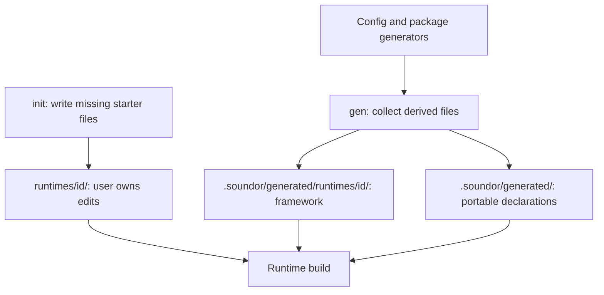

## Purpose

Users edit their host and DSP code. Soundor regenerates the bindings and
framework around it. Keeping these responsibilities separate lets a config or
package update refresh the framework without replacing the user's work.

## Where the code is

`packages/cli/src/commands/init.ts` and `gen.ts` orchestrate the phases.
`packages/core/src/paths.ts`, `codegen.ts` and `generate.ts` define the output
paths, collection and writing. Each runtime's `scaffold.ts` defines its initial
host files; its `codegen.ts` produces derived framework files.

## How it works

| Location                            | Owner and lifetime                                       |
| ----------------------------------- | -------------------------------------------------------- |
| `runtimes/<id>/`                    | User-owned host files, created once by `init`            |
| `.soundor/generated/`               | Shared declarations, regenerated from config             |
| `.soundor/generated/runtimes/<id>/` | Runtime codegen output, exposed as `ctx.paths.gen`       |
| `.soundor/cache/<id>/`              | Runtime scratch/build data, exposed as `ctx.paths.cache` |
| `.soundor/dist/<id>/`               | Runtime build output, exposed as `ctx.paths.dist`        |
| `.soundor/ui/`                      | CLI-owned UI bundles and their assets                    |

`init` checks whether each destination exists before writing a starter file.
`gen` emits relative paths and contents through `ctx.codegen`; the CLI writes
them or compares them for `--check`. This separation makes check mode useful
without invoking a build or overwriting a source file.

## Invariants and tests

`init` must preserve edited host files when run again. `gen` must be
deterministic and must not write its own generated files as a side effect,
because the CLI owns check mode. Generated paths cannot escape their output
directory. Core's file checks detect missing and stale expected files; they
do not promise to remove obsolete files.

Runtime phase tests check scaffolding and preservation. Core's `codegen.test.ts`,
`generate.test.ts` and `paths.test.ts`, plus CLI `init.test.ts` and `gen.test.ts`,
cover collection, safe paths, output layout and command behavior. JUCE golden
files additionally compile generated native bindings in adapter tests.

## How to change it

Put code needed by every plugin in the runtime package or generated framework.
Reserve `init` templates for the files users are expected to edit. If an older
user-owned file must change, document the migration; a template edit only
changes newly initialized files.

Change a generator and review its output together. Test `init` twice with an
edit between calls, and run generation followed by `gen --check`. Keep secrets,
timestamps and machine-specific transient state out of deterministic output.
