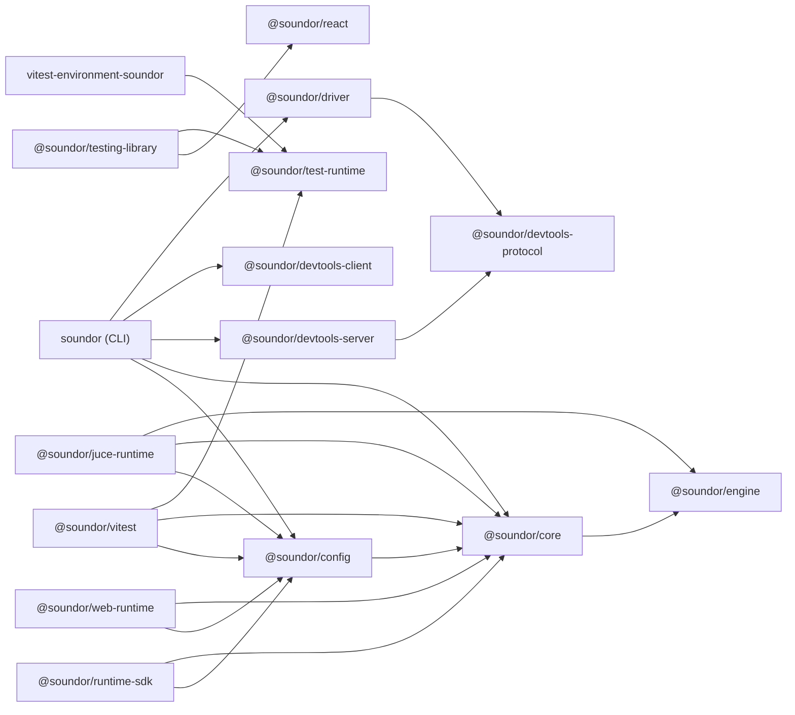

## Purpose

The repository is a pnpm workspace: published packages under `packages/`,
the runtimes and the engine under `runtimes/`, private shared configs under
`configs/`, the examples under `examples/` and the website under
`apps/website`.

## Where the code is

The table below maps packages to their source directories and guides. Each
package's `package.json` declares the dependencies that govern build ordering,
release versioning and affected-package detection.

## How it works

How the published packages depend on each other (`dependencies` and
`peerDependencies`; an arrow points at what a package needs):

`@soundor/react` depends on no Soundor package: it compiles against the
`soundor:*` declarations, which every runtime provides. `create-soundor-app`
depends on none either: it copies a template and installs the others.

| Area              | Package                                                                                                                                                                         | Responsibility                                                                               |
| ----------------- | ------------------------------------------------------------------------------------------------------------------------------------------------------------------------------- | -------------------------------------------------------------------------------------------- |
| Configuration     | [`@soundor/config`](/docs/cli/config)                                                                                                                                           | Config loading, validation, runtime types, and user settings                                 |
| Runtime authoring | [`@soundor/runtime-sdk`](/docs/contribute/runtime-sdk)                                                                                                                          | Factories and lifecycle hooks for runtime packages                                           |
| Shared toolchain  | [`@soundor/core`](/docs/contribute/core)                                                                                                                                        | Code generation, paths, errors, logging, commands, and shared helpers                        |
| Commands          | [`soundor`](/docs/cli)                                                                                                                                                          | `init`, `gen`, `dev`, `build`, `doctor`, `driver`; UI bundling and development sessions      |
| New projects      | [`create-soundor-app`](/docs/cli/create-soundor-app)                                                                                                                            | Project template, dependency installation, and runtime initialization                        |
| UI                | [`@soundor/react`](/docs/react)                                                                                                                                                 | React reconciler, components, hooks, focus scopes, portals, and modals                       |
| Native engine     | [`@soundor/engine`](/docs/contribute/engine-reference)                                                                                                                          | Backend-independent C++ UI engine and Hermes module lowering                                 |
| Native host       | [`@soundor/juce-runtime`](/docs/juce-runtime)                                                                                                                                   | JUCE code generation, parameter and native API adapters, plugin builds                       |
| Browser host      | [`@soundor/web-runtime`](/docs/web-runtime)                                                                                                                                     | DOM-backed UI, Web Audio host, browser services, and Vite integration                        |
| DevTools          | [Client](/docs/contribute/devtools-client), [server](/docs/contribute/devtools-server), [protocol](/docs/contribute/devtools-protocol)                                          | Browser dashboard, authenticated session backend, and shared transport contract              |
| Driver            | [`@soundor/driver`](/docs/driver)                                                                                                                                               | Connected inspection of running plugins from Node.js and `soundor driver`                    |
| Testing           | [Vitest plugin](/docs/testing/vitest), [environment](/docs/testing/vitest-environment-soundor), [Testing Library](/docs/testing), [test runtime](/docs/contribute/test-runtime) | Per-test runtime isolation, semantic queries, interactions, and deterministic animation time |

The engine is versioned independently of the shared package release group.
The JUCE runtime depends on an exact engine version. `@soundor/core` re-exports
the engine's JavaScript module-lowering tool; the engine does not depend on core.

## Invariants and tests

The dependency graph must describe every input a package consumes in CI.
Native job detection uses `turbo query affected`, so an undeclared dependency
can skip a required build. `.github/scripts/native-changes.test.mjs` exercises
that detection, and package build and consumer smoke tests check published
entry points.

The React renderer compiles against portable `soundor:*` declarations; it must
not import a concrete runtime. Its private testing workspace prevents a cycle
between renderer and testing helpers. Engine headers and sources remain
backend-independent, with JUCE code in the JUCE runtime.

## How to change it

Put a feature in the package that owns its contract and lifetime. Declare any
new package dependency in `package.json` using the workspace catalog or
workspace protocol as appropriate. Build and test consumers of a changed
public entry point, and add a changeset when a published package changes.
