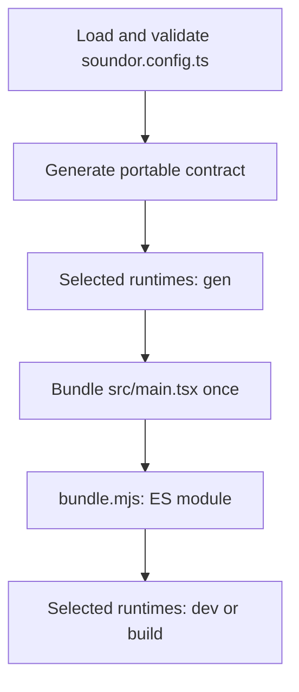

## Purpose

The toolchain turns a project's config and UI into a contract and a bundle,
then asks each selected runtime to build or run them. The CLI orchestrates the
phases; runtimes own their build graph and execution.

## Where the code is

| Source                                                 | Responsibility                                 |
| ------------------------------------------------------ | ---------------------------------------------- |
| `packages/config/src/load.ts`, `schema.ts`, `parse.ts` | Load and validate config                       |
| `packages/config/src/registry.ts`                      | Resolve descriptors and dispatch phases        |
| `packages/core/src/generate.ts` and `*-dts.ts`         | Portable generated declarations                |
| `packages/cli/src/commands/`                           | Command ordering and runtime selection         |
| `packages/cli/src/ui/bundle.ts`                        | Shared UI bundling                             |
| `packages/cli/src/dev/`                                | Watch sessions, logs, source maps and terminal |

## How it works

Config imports live runtime factories, such as `juceRuntime()`; their
descriptors carry an ID, options and the implementation. Resolution uses these
descriptors. The CLI does not import a concrete runtime to dispatch a command.

`soundor gen` first writes portable declarations, then collects each runtime's
`ctx.codegen` output under its generated directory. `--check` compares expected
contents without writing. [Ownership](/docs/contribute/ownership) lists the
directories and explains why `init` is separate.

`soundor build` runs generation in production mode, bundles the UI once, then
calls the selected runtimes in production mode. It records per-runtime results
and reports an aggregate error after attempting the runtime builds.

The bundler inlines npm dependencies and leaves `soundor:*` imports for the
runtime. `bundle.mjs` is an ES2023 module. A runtime that runs another form
makes it: the JUCE runtime lowers it into a CommonJS module function for
Hermes with the engine's `toNativeModule()` (`@soundor/engine/native-module`),
so the lowering matches the engine it links. Assets travel with the bundle. A project with
no `src/main.ts[x]` has no `ctx.ui`; runtimes must handle that case.

During development the CLI watches the UI, rebuilds its directory in place,
and writes `build-id` last after a successful build. The runtime reloads from
that directory. The CLI tails the runtime's JSON-lines UI log and maps stack
frames through source maps: `bundle.mjs`'s, and any a runtime registers with
`ctx.ui.live.sourceMap()` for the form it made. Runtime-specific native builds or browser serving
remain the runtime's job.

## Invariants and tests

The bundle is shared by runtimes and contains no runtime-specific module
implementation. Generation is deterministic and `--check` does not write.
Runtime failures retain their ID and lifecycle phase. Build and dev commands
pass the appropriate mode and bundle context.

`packages/cli/src/commands/*.test.ts` checks orchestration and failure reporting;
`ui/bundle.test.ts` checks bundling. Config registry tests cover dispatch, and
core generation tests cover declarations and stale-file detection. The dev
directory has focused tests for logs, source maps, terminal and shortcuts.

## How to change it

Start with the command's orchestration test. Change config validation and
portable generation before runtime-specific consumers when the contract
changes. Keep the native and ES module bundle forms equivalent. For a new
lifecycle field, update its type, dispatch, SDK re-exports and tests, then the
[runtime lifecycle guide](/docs/contribute/build-runtime/lifecycle).
