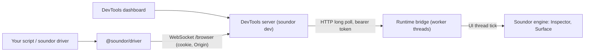

Source: [`packages/driver/`](https://github.com/soundor/soundor/tree/main/packages/driver).

Soundor Driver works with a Soundor plugin that is already running: it reads
the native UI the engine really has (its node tree, bounds, styles and
accessibility) from Node.js or from the `soundor driver` commands. Use it to
debug a plugin, to look at a control while you work on it, to write scripts
that reproduce a UI bug, and from coding agents that need a reliable,
machine-readable view of the UI.

It is a client of the [DevTools](/docs/cli/devtools) session of
[`soundor dev`](/docs/cli/dev): it signs in the way the DevTools dashboard
does and uses the same [protocol](/docs/contribute/devtools-protocol). The
dashboard and any number of Driver clients can watch one plugin at once.

Soundor Driver is not:

- a test runner: use it from any script or test runner, or none;
- a plugin host or launcher: it attaches to a plugin that `soundor dev`
  started (a JUCE Standalone with DevTools);
- parameter automation, nor an audio or MIDI driver: it works with the UI
  only, never with audio processing;
- a browser automation tool: the [Web runtime](/docs/web-runtime) runs in
  a browser, which has its own tools.

## Quick start

Start the plugin with DevTools, as usual:

```sh
pnpm exec soundor dev juce
```

`dev` prints the path of the session's protected descriptor, as "DevTools
session file". Give it to the Driver, here through the environment:

```sh
export SOUNDOR_DEVTOOLS_SESSION=/tmp/soundor-devtools-…/….json
```

Give a node a [`debugId`](#finding-nodes) to find it by:

```tsx
<Pressable debugId="reset" onPress={reset}>
  <Text>Reset</Text>
</Pressable>
```

From the command line:

```sh
pnpm exec soundor driver targets
pnpm exec soundor driver tree --json
pnpm exec soundor driver inspect reset
```

From TypeScript, with `@soundor/driver`:

```sh
pnpm add -D @soundor/driver
```

```ts
import { connect } from '@soundor/driver';

const driver = await connect(); // $SOUNDOR_DEVTOOLS_SESSION
try {
  const tree = await driver.getTree();
  console.log(`${tree.nodes.length} nodes`);
  const reset = driver.getByDebugId('reset');
  console.log(await reset.getBounds());
  console.log(await reset.getAccessibility());
} finally {
  await driver.disconnect();
}
```

## Finding nodes

Locators find nodes by what the engine knows of them:

- `getByDebugId(id)`: the node whose `debugId` prop (on every
  [component](/docs/components), and `node.debugId` in
  [`soundor:ui`](/docs/api/ui)) is `id`. It is for tools only: users and
  assistive technology never see it. DevTools shows it too.
- `getByRole(role, { name })`: a node assistive technology sees with this
  role, and this accessible name.
- `getByText(text)`: a text or input node showing this text.

A locator is a query, not a node: each call finds the node again, so it
follows re-renders and reloads. See [Inspecting UI](/docs/driver/inspecting).

## How it works



1. The Driver reads the descriptor's `browserKey`, exchanges it at
   `POST /browser/auth` for the session's cookie, and opens the `/browser`
   WebSocket with it and the session's own Origin, as the dashboard does.
2. It sends typed, validated requests (`UI.getTree`, `UI.getNode`, …) for its
   selected target. The server checks the target's capabilities and, for
   commands that change anything, the control lease, then queues the command
   for that instance.
3. The plugin's runtime bridge long-polls the server from worker threads and
   hands commands to the engine's Inspector on the UI thread, in its 60 Hz
   tick. The Inspector reads the engine's `Surface` and answers; the bridge
   posts the answer back, and the server relays it to the Driver.

Nothing blocks the UI or audio thread on the network. Node references are
pairs of an opaque ID and a runtime generation: a reload starts a new
generation, and the references of the old one are refused.

## Security

DevTools runs only in development: the engine compiles its inspector only in
Debug builds with DevTools enabled, which `soundor build` never makes, and a
plugin connects only when `soundor dev` hands it a session.

- The server listens on 127.0.0.1 only. The Driver refuses any other
  endpoint, so the key is never sent to another host.
- The Driver signs in with the session's browser key, never with the
  plugin's runtime token, and the server refuses that token from browsers.
- The descriptor holding the key is private to your user (mode 0600 in a
  private directory) and removed when the session ends. The Driver refuses
  a descriptor other users can read.
- Keys never appear in Driver errors, CLI output or URLs. Pass a key to the
  CLI through the environment, not as an argument.

## Limitations

- It attaches to running plugins only: JUCE Standalones started by
  `soundor dev juce`, on macOS, Windows and Linux. Plugins inside a DAW have
  no DevTools session yet.
- A tree snapshot holds at most 5000 nodes; a locator reports when the node
  may be beyond a truncated snapshot.
- Inspection is read-only.

## Pages

- [Connecting to a running plugin](/docs/driver/connecting): sessions,
  targets, timeouts, errors.
- [Inspecting UI](/docs/driver/inspecting): the tree, node details and
  locators.
- [CLI reference](/docs/driver/cli): `soundor driver`, its JSON output and exit
  codes.
