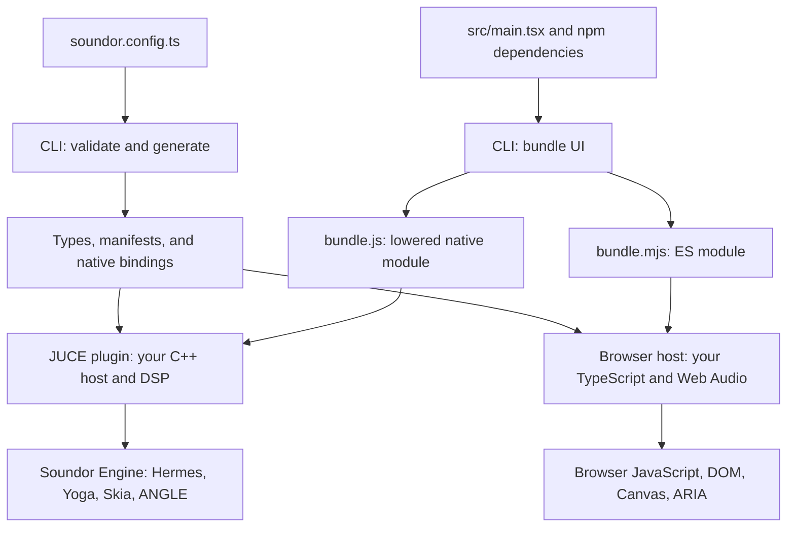

# Architecture

[Documentation](README.md) · [The idea](overview.md) · [Getting started](getting-started.md) · [Architecture](architecture.md)

**On this page**

- [From project to runtime](#from-project-to-runtime)
- [Package responsibilities](#package-responsibilities)
- [The runtime contract](#the-runtime-contract)
- [Native rendering](#native-rendering)
- [Threads and ownership](#threads-and-ownership)
- [Browser rendering and services](#browser-rendering-and-services)
- [Accessibility and input](#accessibility-and-input)
- [Development and test boundaries](#development-and-test-boundaries)

Soundor has a build-time toolchain and runtime implementations. The toolchain
turns a project contract and UI source into generated bindings and bundles. Each
runtime supplies the same UI-facing modules using its own platform services.

## From project to runtime

The CLI bundles npm dependencies into the UI and leaves `soundor:*` imports for
the runtime. It emits an ES module for the web and a module function lowered
for Hermes. Production native builds compile that module to bytecode with the
matching `hermesc`.

## Package responsibilities

| Area              | Package                                                                                                                                          | Responsibility                                                                               |
| ----------------- | ------------------------------------------------------------------------------------------------------------------------------------------------ | -------------------------------------------------------------------------------------------- |
| Configuration     | [`@soundor/config`](config.md)                                                                                                                   | Config loading, validation, runtime types, and user settings                                 |
| Runtime authoring | [`@soundor/runtime-sdk`](runtime-sdk.md)                                                                                                         | Factories and lifecycle hooks for runtime packages                                           |
| Shared toolchain  | [`@soundor/core`](core.md)                                                                                                                       | Code generation, paths, errors, logging, commands, and shared helpers                        |
| Commands          | [`soundor`](cli.md)                                                                                                                              | `init`, `gen`, `dev`, `build`, and `doctor`; UI bundling and development sessions            |
| New projects      | [`create-soundor-app`](create-soundor-app.md)                                                                                                    | Project template, dependency installation, and runtime initialization                        |
| UI                | [`@soundor/react`](react.md)                                                                                                                     | React reconciler, components, hooks, focus scopes, portals, and modals                       |
| Native engine     | [`@soundor/engine`](engine-reference.md)                                                                                                         | Backend-independent C++ UI engine and Hermes module lowering                                 |
| Native host       | [`@soundor/juce-runtime`](juce-runtime.md)                                                                                                       | JUCE code generation, parameter and native API adapters, plugin builds                       |
| Browser host      | [`@soundor/web-runtime`](web-runtime.md)                                                                                                         | DOM-backed UI, Web Audio host, browser services, and Vite integration                        |
| DevTools          | [Client](devtools-client.md), [server](devtools-server.md), [protocol](devtools-protocol.md)                                                     | Browser dashboard, authenticated session backend, and shared transport contract              |
| Testing           | [Vitest plugin](vitest.md), [environment](vitest-environment-soundor.md), [Testing Library](testing-library.md), [test runtime](test-runtime.md) | Per-test runtime isolation, semantic queries, interactions, and deterministic animation time |

The engine is versioned independently of the shared package release group.
The JUCE runtime depends on an exact engine version. `@soundor/core` re-exports
the engine's JavaScript module-lowering tool; the engine does not depend on core.

## The runtime contract

Every runtime implements the `soundor:*` modules and the supported Web globals.
Generated TypeScript declarations come from the project configuration, so the
UI sees the configured parameters and native methods rather than an untyped
dictionary.

Matching semantics matter as much as matching signatures. The web runtime
reproduces native parameter clamping and gestures, input routing, layout
defaults, accessibility rules, and errors where applicable. A change to a
shared behavior usually needs native, web, and test-runtime updates.

The browser naturally has additional APIs. Portable UI code should compile
against Soundor's generated declarations without TypeScript's full `DOM`
library. Browser-host files have their own DOM-enabled TypeScript configuration.

## Native rendering

Each open native editor owns a `RuntimeHost`: a Hermes JavaScript world, UI
surface, runtime modules, services, and pending work. React updates the surface's
node tree through `soundor:ui`.

1. Yoga computes logical layout when it changes.
2. Skia rasterizes damaged UI content and 2D canvases into CPU layers.
3. Canvas WebGL draws through ANGLE into GPU textures when a device exists.
4. Soundor's compositor combines the layers and presents the frame.

The GPU compositor uses ANGLE on Metal or Direct3D 11 where available. Linux and
fallback paths use CPU composition. GPU WebGL can still exist with CPU
composition, where presentation requires readback. The compatible GPU
composition path shares textures without WebGL readback.

Damage tracking and caching avoid repeating layout, rasterization, and texture
uploads for unchanged content. Native opacity and transform animations can
advance in the C++ timeline without a JavaScript callback for each intermediate
frame. Paint animations repaint affected content. See the
[rendering reference](engine-reference.md#rendering) and
[animation contract](engine-reference.md#advanced-animations).

## Threads and ownership

JavaScript, node mutation, event dispatch, and native animation timelines run on
the UI/message thread. The generated editor calls `RuntimeHost::tick()` at
60 Hz to deliver pending parameter changes, run timers, and settle async work.

Audio callbacks execute your native DSP. Parameter listeners that may run on
the audio thread only set lock-free flags; the UI thread later delivers
subscriptions. JavaScript never executes on the audio thread.

Background I/O returns plain C++ results and an operation ID to the owning
thread. JavaScript values stay with their context. Reload tears down the old
host before creating a new one, including pending jobs and subscriptions.

Multiple plugins share a DAW process. Engine symbols have hidden visibility,
dependencies are statically linked, and the engine version determines its inline
C++ ABI namespace. Link-time checks reject incompatible headers and libraries.
See [Symbol isolation](engine-reference.md#symbol-isolation) and
[ABI versioning](engine.md#abi-versioning).

## Browser rendering and services

The same React renderer produces Soundor nodes backed by DOM elements. The web
runtime provides Yoga-like layout defaults, Soundor event routing and focus
behavior, and root/overlay stacking inside the plugin viewport.

One page or iframe owns one host context. The UI, `native.ts`, `audio.ts`, and
host controls share it directly. Native API calls are ordinary TypeScript calls;
there is no serialization boundary. Storage and the private file tree use
IndexedDB, isolated by plugin ID.

The CLI still bundles `src/main.tsx`. Vite serves or builds the browser host and
resolves the bundle's `soundor:*` imports. See the
[web runtime](web-runtime.md#vite-and-the-plugin-ui).

## Accessibility and input

Soundor derives a semantic tree from node accessibility properties, including
roles, labels, values, modal visibility, and logical ownership through portals.
That tree drives native platform bridges and the web runtime's ARIA attributes.

Windows and Linux use AccessKit; macOS uses Soundor's Apple bridge. The engine
also contains an iOS bridge, but Soundor has no iOS plugin build yet. JUCE
supplies the native view and attachment point. It does not define Soundor's
control semantics.

Pointer and keyboard routing also follow the Soundor tree. React's `Modal` and
`FocusScope` add keyboard focus management. Details and examples live in the
[React reference](react.md#accessibility),
[native accessibility reference](engine-reference.md#accessibility), and
[Apple bridge guide](apple-accessibility.md).

## Development and test boundaries

DevTools connects a browser dashboard to an authenticated local server. The
native development Standalone connects through a worker-based bridge, while
inspection and mutations run on the owning UI thread. Node references include a
generation so reload invalidates stale requests. Release builds exclude the
native debug bridge. See [CLI development](cli.md#native-devtools-inspector).

Application tests run in Node against an in-memory runtime. They use the real
React renderer and shared semantic rules, with a virtual clock for animations.
They cover observable UI behavior without doing layout, rendering, native
execution, or audio processing. Native suites and browser tests cover the
platform implementations. See [Testing](testing.md) and
[Contributing](contributing.md).

---

Previous: [Getting started](getting-started.md) · Next: [Project lifecycle](project-lifecycle.md)
