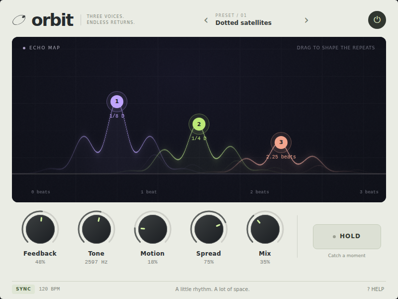

# Orbit

A playable three-voice stereo delay, built with Soundor. One React interface
runs in a JUCE plugin and in a browser. A WebGL 2 echo map visualizes the
parameters; the handles and controls remain usable with a Canvas 2D fallback.



```sh
pnpm --filter orbit dev:web
pnpm --filter orbit typecheck
pnpm --filter orbit test
pnpm --filter orbit test:native
pnpm --filter orbit build:web
pnpm --filter orbit exec soundor build juce
```

Press the host's Play button to hear the original, synthesized demo loop.
The source selector above the plugin switches to the host's input; choose an
audio file in the host settings. Those controls belong to the browser demo,
not to the plugin. The JUCE version always processes the host's audio input.

- Drag an echo horizontally for time, vertically for level. Tab to an echo
  and use left/right for time, up/down for level. Sync snaps edits to 1/32
  notes at the host's tempo; Free uses 500 ms per displayed beat unit.
- Drag knobs vertically, scroll, or use arrows (Shift for larger steps).
  Home restores a knob's default.
- Hold captures each delay line without copying or allocating. Its loop
  remains until released, with a short seam crossfade; time changes alter
  playback speed. The dry input continues, and new input does not enter the
  captured loops. Feedback is ignored while held. Tone, width and mix still work.
- Bypass smoothly returns to the original audio. The delay continues running.
- Preset arrows apply four starting points and release Hold. The preset name
  identifies the starting point; parameter edits do not rename it.

`src/` is portable Soundor UI: no DOM, browser audio, or platform checks.
`runtimes/web/src/processor.ts` runs the browser DSP in an AudioWorklet;
`runtimes/juce/Delay.h` implements the same algorithm in C++. Both use three
filtered, saturated feedback lines, interpolated reads, smoothed delay times
and mix/bypass. The wet signal uses the input's mono sum; the dry signal
preserves stereo. The echo map depicts parameters, not a measured waveform.

WebGL resources are released on unmount. If WebGL is absent or shader setup
fails, a new canvas draws the echo map in 2D. No external assets or libraries
are needed for the graphics or demo audio. Hold is a creative loop, not a
transparent recorder; changing time changes pitch. There is no latency
compensation or oversampling.

The homepage integration is a separate design step. This example is embedded
at [soundor.dev/docs/examples/orbit](https://soundor.dev/docs/examples/orbit).
